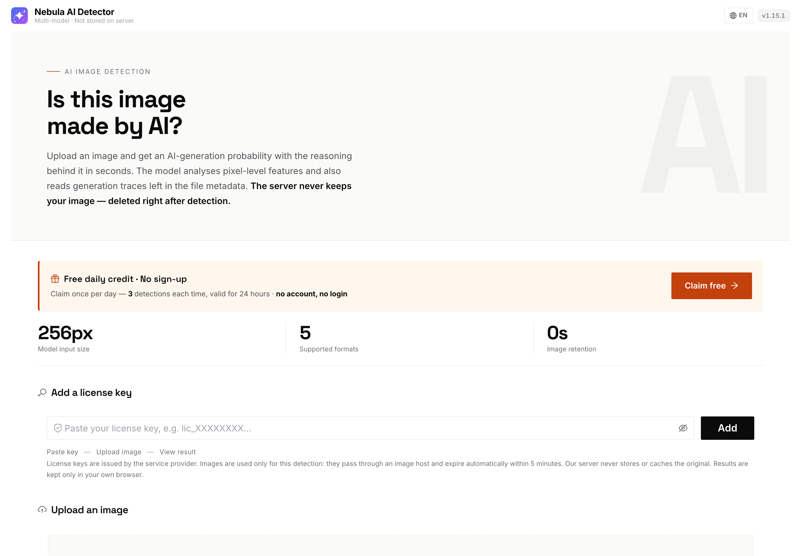
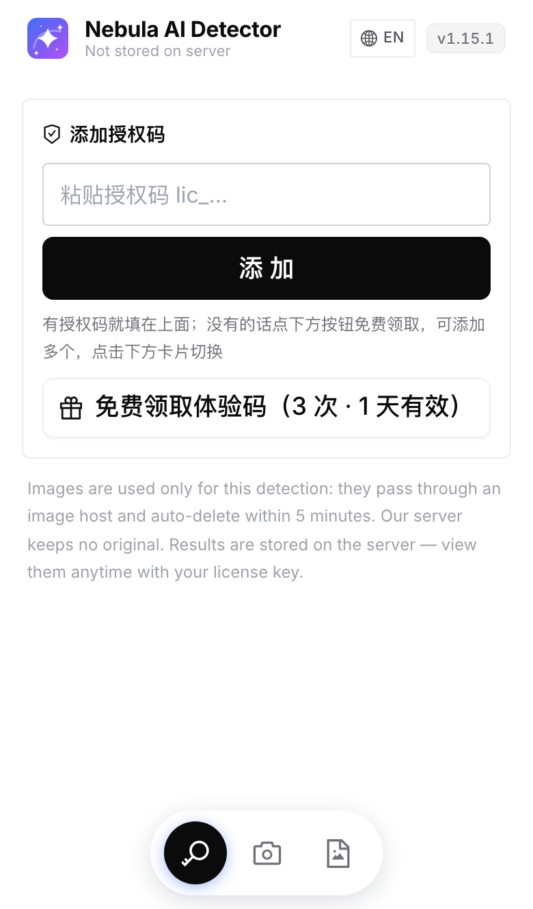
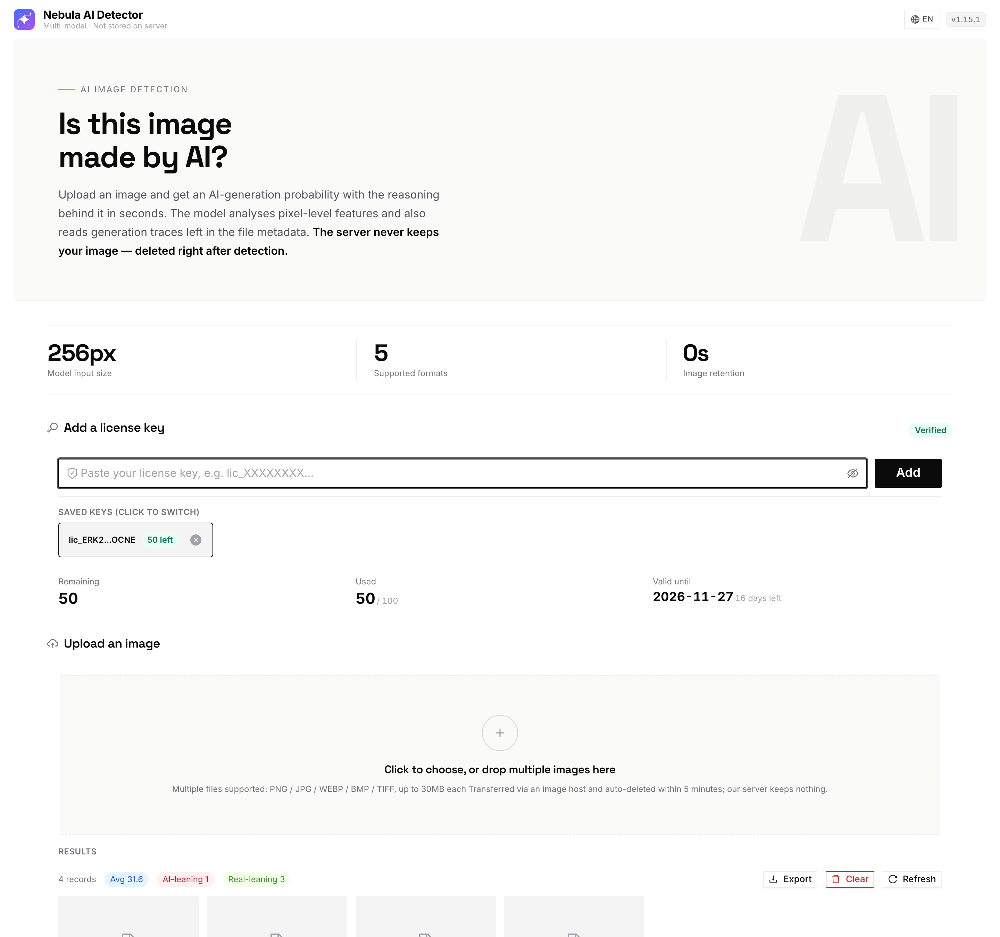

# AI Image Detector

**Free Online AI-Generated Image Checker**

Upload an image and get an AI-generation probability score in seconds — plus the evidence behind it.

[English](#) · [中文](README.md)

---

---

**Try it online:** https://ai-detect.iming.work/en/
**中文版:** https://ai-detect.iming.work/

No install, no sign-up. Runs in any modern browser — 3 free detections per day.

---

## What it does

AI-generated images from Midjourney, Stable Diffusion, DALL·E, Flux and friends are now hard to spot by eye. Is this image AI-generated, or a real photograph, or a human illustration?

This tool answers that from **two independent angles**:

| Angle | What it inspects | Why it matters |
|---|---|---|
| **Metadata** | AIGC content labels, generator signatures, sampling parameters, camera EXIF | A hit is direct, hard evidence |
| **Pixels** | A deep-learning model runs over the image itself | Works even when metadata has been stripped |

Both results are shown **separately** so you can cross-check them — not a single black-box verdict.

---

## How to tell if an image is AI-generated

### Approach 1: check the metadata

Many AI art tools embed generation details when exporting. Common traces:

- **AIGC content labels** — the TC260 standard used in China; some tools embed them
- **Generator signatures** — strings like `Midjourney`, `Stable Diffusion`, `ComfyUI`, `NovelAI`, `DALL·E`, `Flux` in the file's metadata
- **Generation parameters** — sampler (Euler a / DPM++), step count, sometimes prompt fragments. Stable Diffusion WebUI writes the full parameter string into the PNG by default

Conversely, if an image carries **camera make and model** (Canon, Sony, Nikon, Apple iPhone, Huawei…), lens information and shooting parameters, it is most likely a real photograph.

> ⚠️ Metadata has one big weakness: it is trivially stripped. WeChat, Weibo, Xiaohongshu and Douyin all remove EXIF on upload — and a single screenshot wipes it too. So a metadata hit **confirms** AI, but missing metadata **does not** prove an image is real.

### Approach 2: analyse the pixels

AI images often differ from real photographs in fine detail, texture and noise distribution — overly smooth skin, physically implausible highlights, repeating texture patterns, regularities in the frequency domain.

This step is handled by a deep-learning model and does not depend on metadata surviving.

### Approach 3: quick manual checklist

Zoom in and look at these spots — where AI most often gives itself away:

- **Hands** — finger count, joint direction
- **Text** — signage, book pages, on-screen text often comes out as gibberish
- **Backgrounds** — distant people, railings, wires blur into mush
- **Symmetry** — earrings, glasses arms, shoelaces often mismatch left to right
- **Reflections** — eye highlights and glass reflections that break physics

---

## Screenshot

---

## Supported formats

| Item | Detail |
|---|---|
| Formats | PNG, JPG/JPEG, WEBP, BMP, TIF/TIFF |
| Size | Up to 30MB per image |
| Batch | Multiple files at once |
| Devices | Phone, tablet, desktop browser |

---

## Use cases

- Verify whether an image circulating online is AI-generated
- Check whether an illustration or artwork is AI-made
- First-pass screening in content moderation
- Confirm asset provenance before reuse
- Fact-checking images for articles and social posts

---

## Privacy

- Images are used **only** for that single detection
- They pass through an image host and **auto-expire within 5 minutes**
- **Our server never stores or caches the original image**
- Results are kept only in your own browser

---

## FAQ

**How accurate is it?**

No tool is 100% accurate. Accuracy is highest on original, uncompressed files. It drops noticeably for images that have been re-compressed, screenshotted, partially repainted, or photographed off a screen.

**Is it free?**

Yes. Claim 3 detections per day, valid for 24 hours — no account, no login.

**Do I have to upload the image?**

Yes — pixel analysis needs the actual file. It is deleted right after use.

**How should I read the AI score?**

0–100, where higher means more likely AI-generated. Roughly: below 30 leans real, above 55 leans AI, and the middle range means the signals are inconclusive — cross-check with metadata and your own eyes.

---

## Links

- English: https://ai-detect.iming.work/en/
- 中文: https://ai-detect.iming.work/
- llms.txt (site summary for AI assistants): https://ai-detect.iming.work/llms.txt

---

## About this repository

This repository is for **project description only** — it does not contain source code.

Issues are welcome if you run into problems or would like support for additional image formats or detection angles.

---

Keywords: AI image detector · AI-generated image checker · is this image AI generated · AIGC detection · AI art detector · Midjourney detector · Stable Diffusion detector · free AI detector
