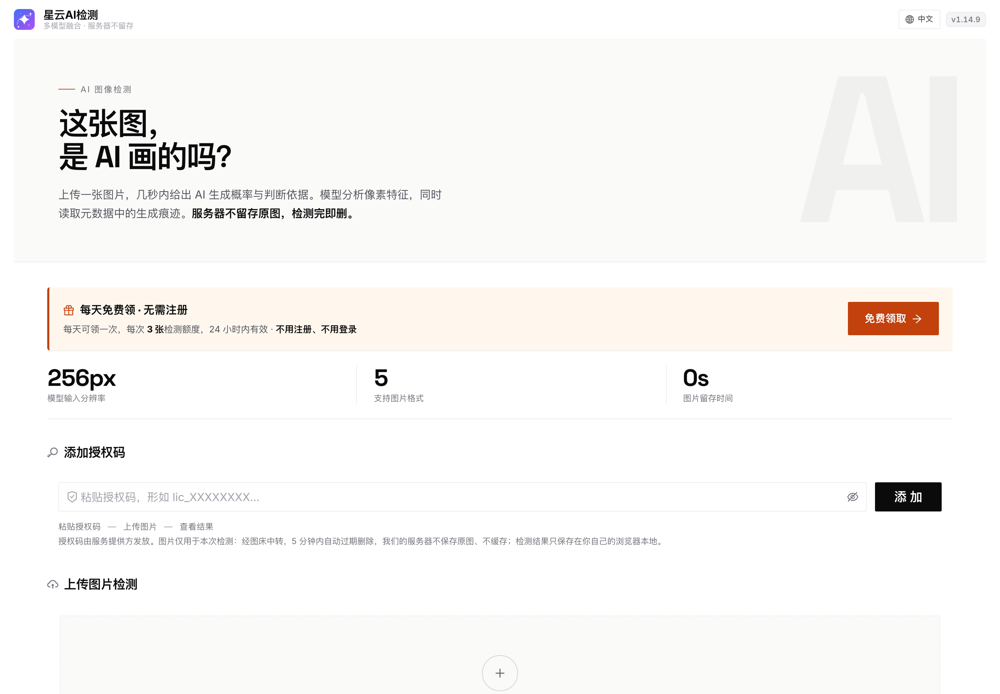
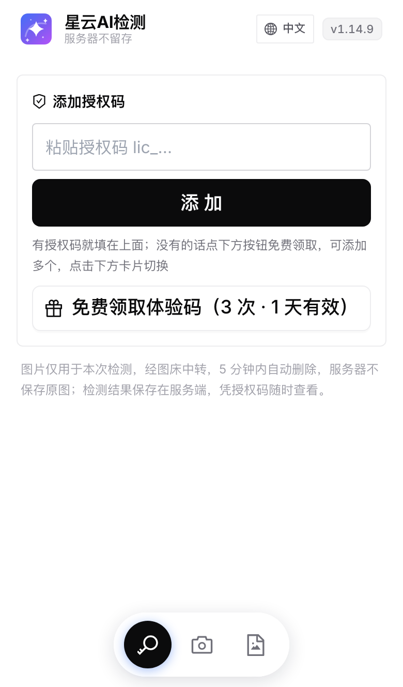
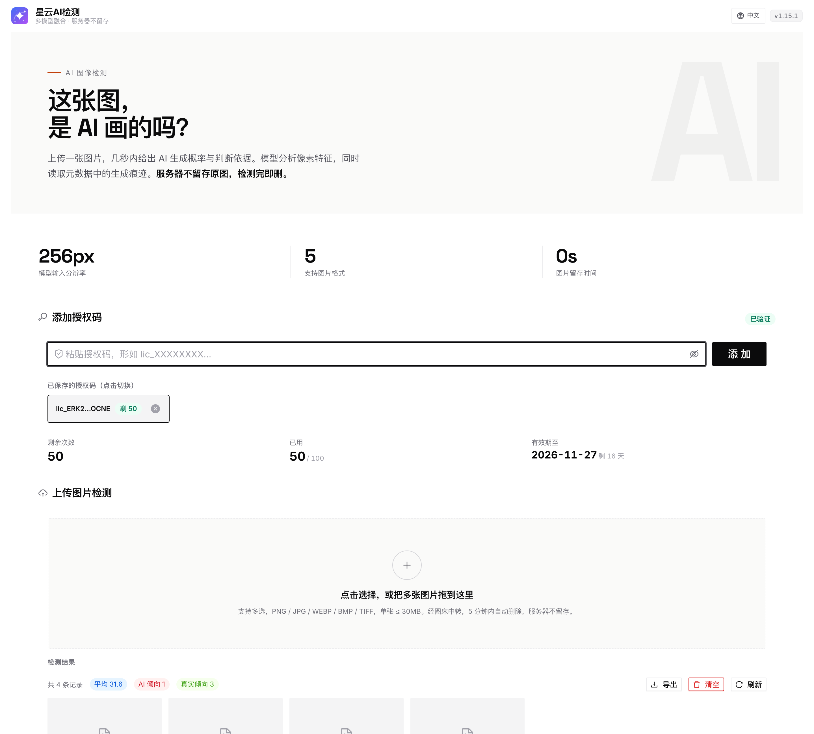

# AI Image Detector

**免费在线 AI 图片检测工具**

上传一张图片，几秒内判断它更可能是 **AI 生成**还是**真实拍摄**，并给出 0~100 的 AI 浓度评分。

[中文](#) · [English](README.md)

---

**在线使用：** https://ai-detect.iming.work
**English version：** https://ai-detect.iming.work/en/

无需安装、无需注册，浏览器打开即可。每天可免费领取 3 次检测额度。

---

## 它解决什么问题

AI 绘画工具（Midjourney、Stable Diffusion、DALL·E、Flux、即梦、可灵……）生成的图片已经很难靠肉眼分辨。这张图是 AI 画的，还是真人拍的、真人画的？

这个工具从两个独立维度给出判断：

| 维度 | 看什么 | 优势 |
|---|---|---|
| **元数据分析** | 文件里的 AIGC 国标标记、生成软件签名、采样参数、相机 EXIF | 命中即可直接确认，证据明确 |
| **像素分析** | 深度学习模型对图像本身做推理 | 不受元数据被清除影响 |

两者**分别呈现**，可以交叉验证——不是只给一个黑箱结论。

---

## 怎么判断一张图片是不是 AI 生成的

### 方法一：检查元数据线索

很多 AI 绘画工具在导出图片时会写入生成信息。常见的有：

- **AIGC 国标标记** — TC260 标准的 AI 生成内容标识，国内部分工具会写入
- **生成软件签名** — 图片元数据里出现 `Midjourney`、`Stable Diffusion`、`ComfyUI`、`NovelAI`、`DALL·E`、`Flux` 等名称
- **生成参数** — 采样器（Euler a / DPM++）、步数、甚至提示词片段。Stable Diffusion WebUI 默认会把完整参数写进 PNG

反过来，如果图片带有**相机厂商与机型**（Canon / Sony / Nikon / Apple iPhone / 华为…）、镜头型号、光圈快门 ISO，则大概率是真实拍摄。

> ⚠️ 元数据有个硬伤：太容易被抹掉。微信、微博、小红书、抖音上传时基本都会剥离 EXIF，截图一次也全没了。所以**元数据命中可以确认是 AI，但没有元数据不能证明是真图**。

### 方法二：分析像素特征

AI 生成的图在细节纹理、噪声分布、边缘处理上与真实照片存在差异——过平滑的皮肤、不合理的高光、重复的纹理 pattern、频率域的规律性。

这一步靠深度学习模型完成，不依赖元数据是否保留。

### 方法三：人工快速排查

放大看这几处，AI 最容易露馅：

- **手** — 手指数量、关节方向
- **文字** — 招牌、书页、屏幕上的字常是乱码
- **背景** — 远处的路人、栏杆、电线容易糊成一片
- **对称性** — 耳环、眼镜腿、鞋带左右常不一致
- **反光** — 眼睛高光、玻璃反射在物理上不合理

---

## 界面预览

---

## 支持的格式

| 项目 | 说明 |
|---|---|
| 图片格式 | PNG、JPG/JPEG、WEBP、BMP、TIF/TIFF |
| 单张大小 | ≤ 30MB |
| 批量 | 支持一次上传多张 |
| 设备 | 手机、平板、电脑浏览器均可 |

---

## 适用场景

- 核查网传图片是否为 AI 生成，辨别真伪
- 判断一幅插画 / 画作是否为 AI 绘画作品
- 内容审核时辅助初筛
- 素材来源确认，避免误用 AI 图
- 自媒体 / 新闻配图的真实性核查

---

## 隐私说明

- 图片仅用于本次检测，**经图床中转，5 分钟内自动过期删除**
- 我们的服务器**不保存原图、不缓存**
- 检测结果只保存在你自己的浏览器本地

---

## 常见问题

**Q：检测准确率有多高？**

没有工具能做到 100%。原始文件、未压缩的图片准确率最高。经过二次压缩、截图、局部重绘、或者 AI 图再拍照的，识别率会明显下降。

**Q：免费吗？**

免费。每天可以领取 3 次检测额度，24 小时内有效，不用注册也不用登录。

**Q：需要上传图片才能检测吗？**

是的。像素分析必须拿到图片本身。图片用完即删，不留存。

**Q：AI 浓度分数怎么理解？**

0~100，分数越高越可能是 AI 生成。一般 30 以下倾向真实，55 以上倾向 AI，中间区间表示特征不明确，建议结合元数据和人工判断。

---

## 相关链接

- 中文版：https://ai-detect.iming.work/
- English：https://ai-detect.iming.work/en/
- 给 AI 助手读的站点说明（llms.txt）：https://ai-detect.iming.work/llms.txt

---

## 关于这个仓库

本仓库只用于**项目介绍与说明**，不包含源码。

如果你在使用中遇到问题、或者希望支持新的图片格式 / 检测维度，欢迎提 Issue 交流。

---

关键词：AI 图片检测 · AI 生成图片识别 · AIGC 检测 · AI 绘画检测 · 图片真伪鉴别 · AI image detector · Midjourney detector · Stable Diffusion detector
